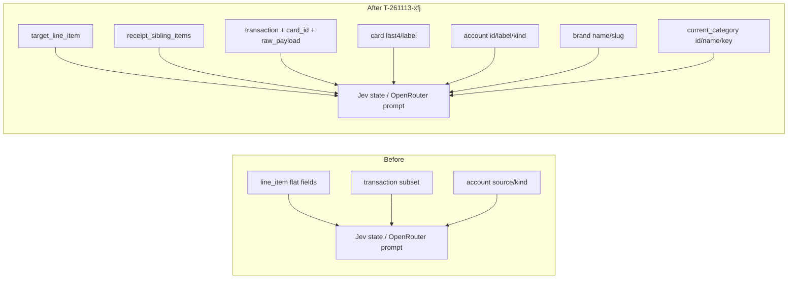
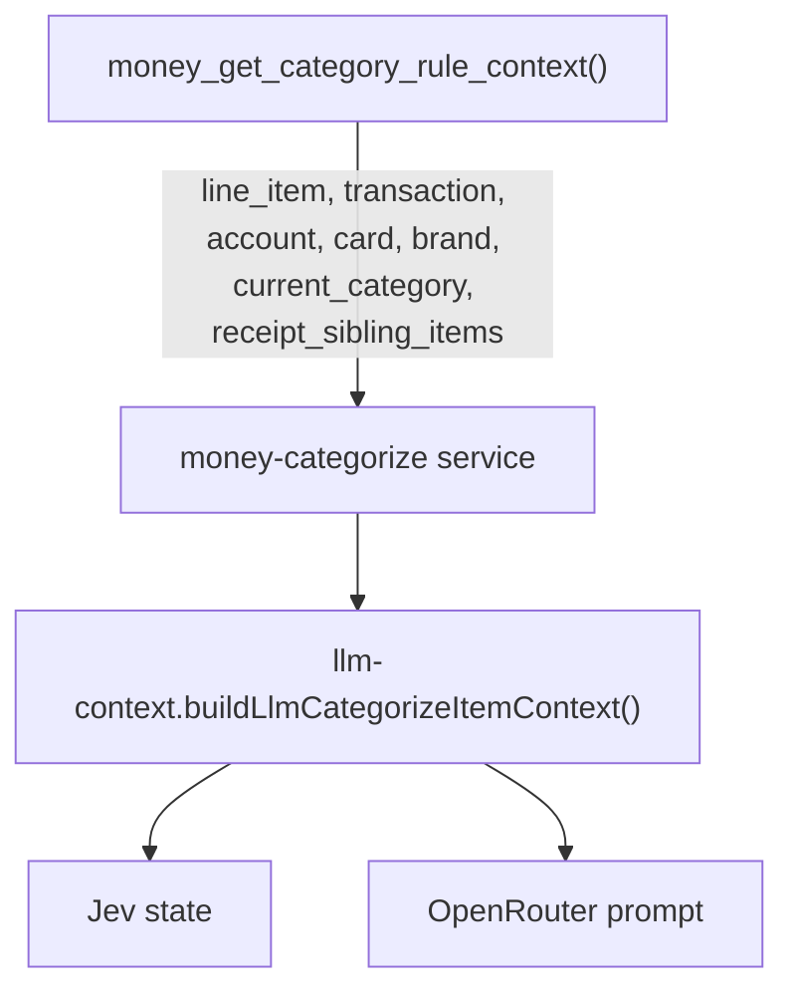

# Money categorize LLM context (parent + siblings)

## Intent

Give Jev and OpenRouter the same rich parent transaction context when classifying a
single receipt line, while making the classification target explicit so sibling lines
are context only.

## Before → after

## Data path

## Contract notes

- `target_line_item` is the only line to classify.
- `receipt_sibling_items` is always present: populated for multi-line receipts, `[]` for
  single-line.
- `transaction.raw_payload` / line `raw_payload` are truncated at the LLM boundary
  (`LLM_RAW_PAYLOAD_MAX_BYTES`) while the SQL context keeps the full payload for rules.
- Sibling list is capped at 40 rows in SQL to bound prompt size.

## References

- `supabase/db/functions/money_get_category_rule_context.sql`
- `supabase/functions/money-categorize/llm-context.ts`
- `supabase/functions/money-categorize/jev-categorize.ts`
- `supabase/functions/money-categorize/openrouter-categorize.ts`
